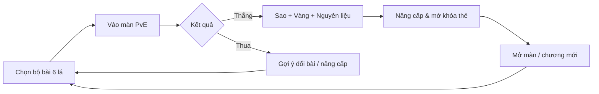
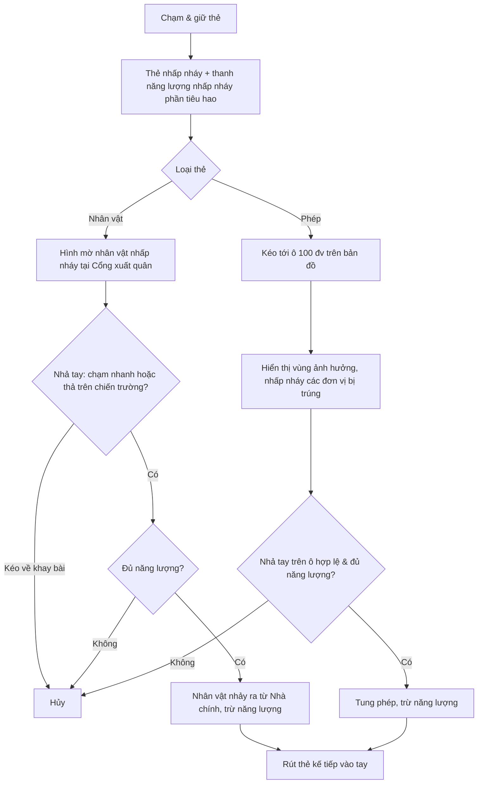
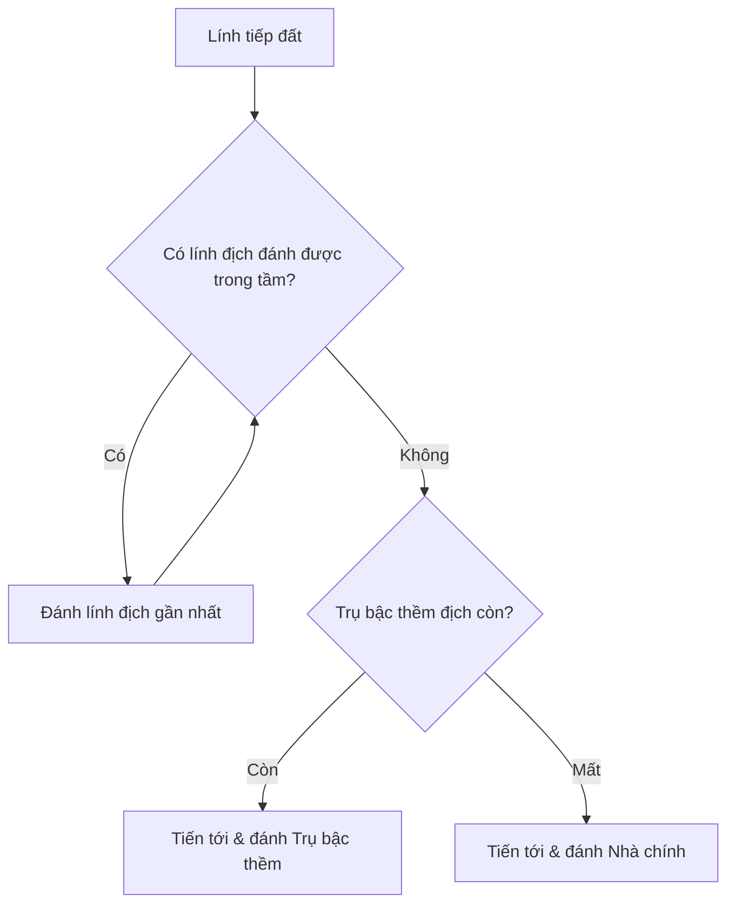
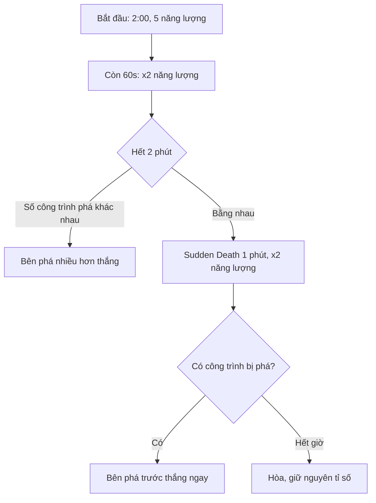

# GAME DESIGN DOCUMENT
# FOOD CLASH: MOLD INVASION (PROJECT 20261)

> **Tài liệu Thiết kế Game (GDD)** theo cấu trúc **Form GDD**.
> **Dự án:** Project 20261 – Game chiến thuật thời gian thực 1 làn ngang (Side-scrolling 1-lane Tower Defense & Card Battle), chủ đề **Đồ ăn chiến đấu chống Nấm mốc** (nội dung PvE).
> **Phiên bản:** 2.1 · **Ngày cập nhật:** 01/11/2026
> **Bảng Excel quản lý chỉ số thẻ:** `Card_Stats_Food_Clash.xlsx` (tham chiếu chuẩn Tournament Standard Level 11 từ [noff.gg/clash-royale/cards](https://www.noff.gg/clash-royale/cards)).

### Thay đổi so với phiên bản 1.0
| Hạng mục | v1.0 | v2.1 |
|---|---|---|
| Chủ đề | Đồ ăn đấu đồ ăn (Bếp trưởng tha hóa) | **Đồ ăn chiến đấu chống Đế chế Nấm Mốc** (PvE) |
| Thẻ bài | 6 thẻ mẫu tự đặt | **8 thẻ nhân vật theo Propose** + **2 thẻ phép**, chuẩn hóa chỉ số theo **noff.gg Clash Royale (Level 11)** |
| Thả quân | Kéo thẻ vào ô lưới trong vùng đặt quân 2200 đv | **Lính xuất phát từ cổng Nhà chính** (chạm thẻ hoặc kéo lên chiến trường rồi thả) |
| Thả phép | Kéo thả vào ô lưới, hiển thị vùng ảnh hưởng | **Giữ nguyên**, bán kính quy đổi chuẩn `1 Tile CR = 100 đv Map` |
| Vùng đặt quân 2200 đv & mở rộng khi phá trụ | Có | **Loại bỏ** (không còn cần thiết) |
| Vùng trung hòa 1000 đv | Chưa rõ định nghĩa | **Vùng nằm ngoài tầm bắn của cả 2 Trụ bậc thềm** (x = 3000 → 4000) |
| Bộ sưu tập & Quản lý chỉ số | 6 thẻ = 1 bộ bài | **10 thẻ khởi điểm** (chọn 6 thẻ vào trận), quản lý trong file Excel `Card_Stats_Food_Clash.xlsx` |

---

## 1. Game Overview

### 1.1 Introduction
*Food Clash: Mold Invasion* là game chiến thuật thời gian thực trên chiến trường **1 làn ngang**. Bên trái là căn cứ của người chơi, gồm **Tủ Lạnh Tổng** (Nhà chính) và **Ấm Siêu Tốc** (Trụ bậc thềm). Bên phải là căn cứ của **Đế chế Nấm Mốc** (Bot AI), gồm **Ổ Mốc Thùng Rác** và **Nấm Bào Tử**.

Người chơi dùng **Năng lượng Tươi (Fresh Energy)**, hồi 1 điểm mỗi 2.4 giây, để đánh các thẻ bài trên tay:
- **Thẻ nhân vật đồ ăn** (đô vật socola, cà chua cảm tử, hộp sữa xạ thủ…) xuất phát từ cổng Tủ Lạnh rồi tự hành quân về phía căn cứ nấm mốc.
- **Thẻ phép bảo quản** (Muối Hột, Bom Giấm) được thả trực tiếp vào vị trí bất kỳ trên chiến trường.

Mỗi trận kéo dài 2 phút, cộng thêm 1 phút Sudden Death nếu hòa.

**Elevator pitch:** *"Nấm mốc đang tràn khắp căn bếp! Hãy chỉ huy đội quân đồ ăn tươi ngon – từ đô vật socola El Valentino đến xạ thủ hộp sữa Milky Cartoneey – xuất kích từ Tủ Lạnh Tổng, rải muối, ném bom giấm và quét sạch Đế chế Nấm Mốc trong những trận chiến 2 phút nghẹt thở."*

### 1.2 Theme & Backstory
- **Bối cảnh:** **Căn Bếp Gourmetia** – một căn bếp khổng lồ nơi mọi món ăn, thức uống đều có linh hồn. Trái tim của căn bếp là **Tủ Lạnh Tổng**, nơi giữ cho mọi thứ luôn tươi ngon.
- **Phản diện:** **Vua Mốc Moldrak** và **Đế chế Nấm Mốc** trỗi dậy từ những góc bị lãng quên: thùng rác quên đổ, ổ bánh mì để quá hạn, hầm ẩm ướt. Mốc lan tới đâu, đồ ăn hư hỏng tới đó và bị biến thành binh lính mốc.
- **Cốt truyện:** Người chơi vào vai **Người Giữ Tủ Lạnh**, tập hợp những món ăn dũng cảm nhất để đẩy lùi nấm mốc qua từng khu vực của căn bếp, tiến tới tiêu diệt Vua Mốc trong Hầm Ẩm.
- **Phe phái:**
  - *Phe Đồ Ăn Tươi* (người chơi): màu sắc tươi sáng, vui nhộn.
  - *Đế chế Nấm Mốc* (kẻ thù PvE): xanh rêu – tím xám, nhầy nhụa, phát bào tử.

### 1.3 Genre
- **Thể loại:** Real-time Strategy / 1-lane Side-scrolling Tower Defense kết hợp Card Battle (CCG nhẹ), tập trung **PvE**.
- **Game tương tự:**
  - *Tower Conquest*, *Battle Cats*, *Age of War*: lính xuất phát từ căn cứ, đẩy làn ngang.
  - *Clash Royale*: năng lượng tự hồi, bộ bài xoay tua, thả phép có vùng ảnh hưởng, 2 cấp công trình, Sudden Death.
  - *Plants vs. Zombies*: chủ đề đồ vật dễ thương chống lại một đạo quân xâm lược.

### 1.4 Game Fantasy
- **Vị chỉ huy căn bếp:** quyết định *khi nào* tung đô vật socola mở đường, *khi nào* thả Sir Tom lao vào đám bào tử để phát nổ.
- **Thỏa mãn khi "khử mốc":** một nắm Muối Hột rải xuống làm cả đàn bào tử tan biến, Bom Giấm nổ tung hạ gục Nấm Bào Tử.
- **Dễ thương nhưng kịch tính:** nhân vật đồ ăn ngộ nghĩnh đối đầu những khối mốc nhầy nhụa, hiệu ứng tươi sáng trên nền căn bếp ấm áp.
- **Bảo vệ ngôi nhà:** cảm giác giữ cho Tủ Lạnh – biểu tượng của sự tươi ngon – không bị mốc xâm chiếm.

### 1.5 Goal
#### Short-term goal (khoảnh khắc trong trận)
- Quản lý Năng lượng Tươi, chọn thời điểm xuất quân.
- Phối hợp đội hình: tanker đi trước (El Valentino / Avocador), xạ thủ theo sau (Milky, Boba Bob, Lemo-nade).
- Dùng phép đúng chỗ để dọn bầy mốc hoặc kết liễu công trình.
- Giữ Ấm Siêu Tốc (Trụ bậc thềm) không bị phá.

#### Medium-term goal (mỗi phiên chơi)
- Vượt qua màn chơi của chương hiện tại, đạt 3 sao.
- Thử nghiệm và tối ưu bộ bài 6 lá để khắc chế đội hình mốc của từng chương.

#### Goal of the game (dài hạn)
- Giải phóng toàn bộ căn bếp qua các chương và đánh bại Vua Mốc Moldrak.
- Mở khóa, nâng cấp toàn bộ thẻ nhân vật đồ ăn.

### 1.6 Core Loop
**Vòng lặp chính:**
```
Chọn bộ bài 6 lá (-thời gian, +chiến thuật)
 → Vào màn PvE với Đế chế Nấm Mốc (-thể lực)
 → Chiến thắng (+Sao, +Vàng, +Nguyên liệu tươi)
 → Nâng cấp / mở khóa thẻ (-Vàng, -Nguyên liệu, +sức mạnh)
 → Mở khóa màn / chương mới → Chọn lại bộ bài
```



**Vòng lặp trong trận:**
```
Năng lượng hồi (1 / 2.4s) → Chọn thẻ trên tay
 → Thẻ nhân vật: xuất quân tại cổng Tủ Lạnh / Thẻ phép: chọn ô mục tiêu
 → Lính tự hành quân, giao tranh → Rút thẻ kế tiếp (xoay tua 3/6)
 → Phá Nấm Bào Tử (Trụ bậc thềm) → Phá Ổ Mốc Thùng Rác (Nhà chính) → Chiến thắng
```

**Core loop hoạt động thế nào?** Mỗi chương có đội hình mốc đặc trưng (nhiều bầy bào tử, nhiều quân bay, boss trâu bò…). Người chơi phải điều chỉnh bộ bài 6 lá từ bộ sưu tập để khắc chế. Thắng màn sẽ nhận nguyên liệu để nâng cấp thẻ, giúp vượt các màn khó hơn và mở khóa chương mới.

---

## 2. Features List

### 2.1 Feature 1 – Chiến trường & Bản đồ (Battlefield & Map)

#### Overview
**Introduction:** Chiến trường 1 làn ngang với hệ tọa độ chuẩn hóa, chia lưới ô 100 đơn vị.

**Purpose:** Giữ tầm bắn, khoảng cách và vị trí thả phép chính xác, dễ cân bằng và dễ lập trình.

#### UI/Presentation
```
x:   0        700  1000      1800         3000        4000         5200      6000  6300      7000
     |<-1000->|300|  (●)      [▲]  ...tầm trụ...|  TRUNG HÒA  |...tầm trụ...  [▲]      (●)  |300|<-1000->|
     | camera |   | TỦ LẠNH  ẤM SIÊU TỐC        |   1000 đv   |        NẤM BÀO TỬ  Ổ MỐC   |   | camera |
                  |<----------------------- 5000 giữa 2 Nhà chính ----------------------->|
              |<----------------------------- Vùng chơi 5600 ---------------------------------->|
```
*Sơ đồ tọa độ. (●) = Nhà chính, [▲] = Trụ bậc thềm.*

#### Mechanics
**Thông số bản đồ**
| Thông số | Giá trị |
|---|---|
| Tổng chiều dài quan sát (camera) | 7000 đv (lùi 1000 đv sau tâm mỗi Nhà chính) |
| Vùng chơi (giới hạn thả phép) | 5600 đv (lùi 300 đv sau tâm mỗi Nhà chính) → x = 700 … 6300 |
| Khoảng cách 2 Nhà chính | 5000 đv (x = 1000 và x = 6000) |
| Nhà chính ↔ Trụ bậc thềm | 800 đv (Trụ ở x = 1800 và x = 5200) |
| Kích thước Nhà chính / Trụ bậc thềm | Đường kính 400 / 200 đv |
| Tầm bắn Nhà chính / Trụ bậc thềm | 1100 / 1200 đv, tính theo trục hoành |
| Vùng trung hòa | 1000 đv, nằm ngoài tầm bắn của cả 2 Trụ bậc thềm (x = 3000 … 4000) |
| Lưới | Ô ngang 100 đv; mỗi lính thường chiếm 1 ô |

**Cổng xuất quân**
- Mỗi Nhà chính có một **Cổng xuất quân**, đặt ngay trước mặt Nhà chính về phía địch: x = 1250 (người chơi) và x = 5750 (Nấm Mốc).
- Mọi thẻ nhân vật đều xuất hiện tại cổng này.

**Xếp chồng hình ảnh**
- Các lính có thể cùng chiếm một khoảng không gian 2D.
- Lính có kích thước nhỏ được vẽ đè lên lính lớn; lính bay được vẽ trên cùng.

---

### 2.2 Feature 2 – Xuất quân & Thả phép (Deployment)

#### Overview
**Introduction:**
- **Thẻ nhân vật** xuất phát từ cổng Nhà chính (kiểu *Tower Conquest*).
- **Thẻ phép** được kéo thả tới vị trí chọn trên bản đồ (kiểu *Clash Royale*).

**Purpose:** Lính đi ra từ căn cứ nhấn mạnh cảm giác "đẩy làn" và phòng thủ ngôi nhà. Phép thả tự do giữ lại chiều sâu chiến thuật về vị trí và thời điểm.

#### UI/Presentation
```
+--------------------------------------------------------------------------+
| [👑👑👑 BẠN]            2:00 · Năng lượng x1            [NẤM MỐC 👑👑👑]  |
| [=========== minimap toàn bản đồ, khung camera ===========]               |
|  [TỦ LẠNH]>>cổng  [ẤM]   🍫→ 🥛→        ← 🦠🦠  ← 🍄   [NẤM]  [Ổ MỐC]     |
|------------------------------------------------------------------------- |
| Tiếp theo:[🧂]   [🍫 5]  [🍅 2]  [🥛 3]                                  |
|                  💧 ████████░░░░░░░░░░ 4                                  |
+--------------------------------------------------------------------------+
```
*Màn hình trận đấu: HUD ở trên; chiến trường ở giữa; 3 thẻ trên tay, thẻ kế tiếp và thanh năng lượng ở dưới.*

#### Flowchart


#### Mechanics
**Thẻ nhân vật**
1. **Chọn:** chạm và giữ thẻ. Ô thẻ nhấp nháy sáng; hình 2D mờ của nhân vật nhấp nháy tại Cổng xuất quân; thanh năng lượng nhấp nháy số điểm sẽ tiêu hao (nhấp nháy đỏ nếu thiếu).
2. **Xác nhận:** có hai cách:
   - *chạm nhanh* vào thẻ;
   - *kéo thẻ lên chiến trường* rồi nhả tay ở bất kỳ đâu.

   Kéo rồi nhả tay ngoài chiến trường (về khay bài) sẽ hủy thao tác.
3. **Xuất quân:** nhân vật nhảy ra từ Nhà chính, đáp xuống Cổng xuất quân, rồi tự hành quân. Thanh năng lượng trừ điểm tương ứng và hiện dấu trừ (`-X`).
4. **Thẻ nhiều đơn vị** (Chips ×3, Dough Donuts ×2): các đơn vị xuất hiện nối đuôi nhau, mỗi con cách nhau 45 đv về phía sau.

**Thẻ phép (giữ nguyên cơ chế)**
1. Kéo thẻ tới **ô 100 đv** bất kỳ trong vùng chơi (x = 700 … 6300). Ô được chọn phát sáng.
2. Vùng ảnh hưởng của phép nhấp nháy, đồng thời làm nổi bật mọi đơn vị và công trình địch sẽ bị trúng.
3. Nhả tay để tung phép. Phép có thể đánh thẳng vào Nhà chính địch, và **sẽ đánh thức Nhà chính** nếu nó đang ngủ.

---

### 2.3 Feature 3 – Chiến đấu & Công trình (Combat & Towers)

#### Overview
**Introduction:** Quy tắc nhắm mục tiêu, va chạm và hành vi của công trình phòng thủ.

**Purpose:** Thứ tự công phá rõ ràng (Trụ → Nhà chính) và quan hệ khắc chế dễ đọc (lính bay, đánh xa, chỉ đánh công trình…).

#### Flowchart


#### Mechanics
**Công trình (Chuẩn hóa theo King Tower & Princess Tower Level 11 – noff.gg)**
| Công trình | Phe Đồ Ăn | Phe Nấm Mốc | Tham chiếu CR Lv11 | HP | Sát thương | Tốc đánh | DPS | Tầm |
|---|---|---|---|---|---|---|---|---|
| Nhà chính | Tủ Lạnh Tổng (bắn đá viên) | Ổ Mốc Thùng Rác | *King Tower* | **4824** | **109** | **1.0s** | 109.0 | 1100 |
| Trụ bậc thềm | Ấm Siêu Tốc (phun hơi nóng) | Nấm Bào Tử | *Princess Tower* | **3052** | **109** | **0.8s** | 136.3 | 1200 |

- **Trụ bậc thềm:** luôn hoạt động, bắn lính địch gần nhất trong tầm (kể cả lính bay).
- **Nhà chính:** khởi đầu ở trạng thái **ngủ**. Chỉ kích hoạt khi:
  1. bản thân bị dính sát thương, **hoặc**
  2. Trụ bậc thềm cùng phe bị phá.

**Nhắm mục tiêu**
- Lính đánh lính địch gần nhất trong tầm mà nó đánh được. Lính cận chiến mặt đất **không đánh được lính bay**.
- Khi không có lính địch trong tầm, lính tiến về **Trụ bậc thềm** địch. **Cả lính đất lẫn lính bay đều bắt buộc phải phá Trụ bậc thềm** trước khi tấn công Nhà chính.
- **Chỉ đánh công trình** (El Valentino, Mốc Khổng Lồ): bỏ qua mọi lính địch, đi thẳng tới công trình.

**Va chạm**
- Lính cùng phe đi xuyên qua nhau, không chặn đường nhau.
- Lính đứng sau được đánh xuyên qua đồng đội đứng trước.

**Hiệu ứng đặc biệt**
- **Nổ khi tử vong** (Sir Tom): gây sát thương diện rộng quanh vị trí chết, trúng cả lính lẫn công trình.
- **Sát thương lan** (Lemo-nade): đạn gây sát thương cho mọi đơn vị địch trong bán kính quanh điểm trúng.
- **Xuất nhiều đơn vị** (Chips, Dough Donuts): 1 thẻ sinh ra nhiều đơn vị nhỏ.

---

### 2.4 Feature 4 – Thẻ bài & Bộ bài (Cards & Deck – Chuẩn hóa theo noff.gg Clash Royale)

#### Overview
**Introduction:**
- Bộ sưu tập khởi điểm gồm **10 thẻ**: 8 nhân vật theo Propose và 2 phép.
- Toàn bộ chỉ số (Năng lượng, Máu, Sát thương, Tốc đánh, Tầm bắn, Bán kính Spell, Tốc chạy) được chuẩn hóa tương ứng với chuẩn **Tournament Standard (Level 11)** trên [noff.gg/clash-royale/cards](https://www.noff.gg/clash-royale/cards) và quản lý chi tiết trong bảng tính Excel `Card_Stats_Food_Clash.xlsx`.
- Trước mỗi trận, người chơi chọn **6 thẻ** làm bộ bài.

**Purpose:** Đảm bảo tỉ lệ tương tác (Shots-to-Kill, DPS/Elixir, HP/Elixir) cân bằng chặt chẽ ngay từ đầu, dễ dàng tra cứu và tinh chỉnh qua file Excel.

#### UI/Presentation
```
+---------------- CHỌN BỘ BÀI (6/6) ----------------+
| [🍫 El Valentino 5✓] [🍅 Sir Tom 2✓] [🍋 Lemo 5✓]  |
| [🥛 Milky 4✓] [🥑 Avocador 4 ] [🧋 Boba Bob 3 ]   |
| [🥔 Chips 1 ] [🍩 Dough Donuts 3✓] [🧂 Muối 3✓]    |
| [🍾 Bom Giấm 4 ]            Năng lượng TB: 3.7    |
+---------------------------------------------------+
```

#### Mechanics
**Quy tắc quy đổi từ Clash Royale (noff.gg Lv11) sang Bản đồ Project 20261**
- **Đơn vị khoảng cách:** `1 Tile (Clash Royale) = 100 đơn vị (Project 20261)` (tương ứng 1 ô lưới chuẩn 100 đv).
  - *Melee: Short* (`0.5–0.8 tile`) → **80 đv** · *Melee: Medium* (`1.2 tiles`) → **120 đv** · *Flying Short* (`2.0 tiles`) → **200 đv**.
  - *Ranged:* Wizard (`5.5 tiles` → **550 đv**), Musketeer (`6.0 tiles` → **600 đv**), Dart Goblin (`6.5 tiles` → **650 đv**).
  - *Spell / AoE Radius:* Fireball (`2.5 tiles` → **250 đv**), Arrows (`3.5 tiles` → **350 đv**), Wizard Splash (`1.5 tiles` → **150 đv**), Death Bomb (`2.5 tiles` → **250 đv**).
- **Tốc độ di chuyển:** *Slow* (`45`) → **70 đv/s** · *Medium* (`60`) → **95 đv/s** · *Fast* (`90`) → **135 đv/s** · *Very Fast* (`120`) → **175 đv/s**.

**Thẻ nhân vật đồ ăn (theo Propose & Tham chiếu noff.gg Lv11)**
| Thẻ | Tham chiếu noff.gg (Lv11) | Độ hiếm (Khung Level) | Vai trò | 💧 | SL | HP / 1 đv (Lv11) | ST / tốc đánh (DPS Lv11) | Tầm (đv) | Tốc chạy (đv/s) | Cơ chế & Tương tác chuẩn |
|---|---|---|---|---|---|---|---|---|---|---|
| **Chips** 🥔 | **Skeletons** | **Common** *(Lv1→16)* | Bầy cận chiến | **1** | **3** | **81** *(x3 = 243)* | **81** / 1.1s *(220.9)* | **80** *(0.5t)* | **135** *(Fast)* | 1 năng lượng gọi 3 miếng bim bim – xoay bài nhanh, câu kéo lính đơn |
| **Dough Donuts** 🍩 | **Minions** *(biến thể x2)* | **Common** *(Lv1→16)* | Lính bay, tầm ngắn | **3** | **2** | **280** *(x2 = 560)* | **135** / 1.1s *(245.5)* | **200** *(2.0t)* | **135** *(Fast)* | Bay trên không, tầm ngắn 200 đv, đánh cả Đất & Không |
| **El Valentino** 🍫 | **Giant** | **Rare** *(Lv3→16)* | Tanker, chỉ đánh công trình | **5** | 1 | **3968** | **253** / 1.5s *(168.7)* | **120** *(1.2t)* | **70** *(Slow)* | Máu cực lớn, bỏ qua lính, đi thẳng tới đập công trình |
| **Lemo-nade** 🍋 | **Wizard** | **Rare** *(Lv3→16)* | Tầm xa, AoE | **5** | 1 | **755** | **281** / 1.4s *(200.7)* | **550** *(5.5t)* | **95** *(Med)* | Ném chanh nổ lan **AoE 150 đv**, bắn cả Đất & Không |
| **Milky Cartoneey** 🥛 | **Musketeer** | **Rare** *(Lv3→16)* | Tầm xa, bắn đơn | **4** | 1 | **721** | **217** / 1.0s *(217.0)* | **600** *(6.0t)* | **95** *(Med)* | Bắn đơn tầm xa 600 đv, sát thương ổn định, diệt lính bay |
| **Avocador** 🥑 | **Mini P.E.K.K.A** | **Rare** *(Lv3→16)* | Cận chiến, sát thương cao | **4** | 1 | **1390** | **755** / 1.6s *(471.9)* | **80** *(0.8t)* | **135** *(Fast)* | Cú đấm 755 ST (1 đấm hạ Wizard/Musketeer), khắc chế cứng Tanker |
| **Boba Bob** 🧋 | **Dart Goblin** | **Rare** *(Lv3→16)* | Tầm rất xa, bắn nhanh | **3** | 1 | **261** | **151** / 0.8s *(188.8)* | **650** *(6.5t)* | **175** *(V.Fast)* | Tầm bắn xa nhất (650 đv), tốc bắn 0.8s, máu mỏng (bị Muối Hột diệt) |
| **Sir Tom** 🍅 | **Wall Breakers / Giant Skeleton Bomb** | **Epic** *(Lv6→16)* | Cận chiến, cảm tử | **2** | 1 | **560** | **84** / 1.5s *(56.0)* | **80** *(0.8t)* | **95** *(Med)* | Khi tử vong nổ **AoE 250 đv**: **530 ST** lên lính, **265 ST** lên trụ |

**Thẻ phép bảo quản (Tham chiếu noff.gg Lv11)**
| Thẻ | Tham chiếu noff.gg (Lv11) | Độ hiếm (Khung Level) | 💧 | Bán kính (CR → Map) | ST lên lính (Lv11) | ST lên công trình (30%) | Mô tả & Tương tác chuẩn |
|---|---|---|---|---|---|---|---|
| **Muối Hột** 🧂 | **Arrows** | **Common** *(Lv1→16)* | **3** | **350 đv** *(3.5 tiles)* | **366** | **111** | Diện rộng 350 đv, diệt gọn *Chips* (81 HP), *Boba Bob* (261 HP), *Dough Donuts* (280 HP), *Ruồi Giấm* (230 HP) |
| **Bom Giấm** 🍾 | **Fireball** | **Rare** *(Lv3→16)* | **4** | **250 đv** *(2.5 tiles)* | **689** | **207** | Bán kính 250 đv, kéo máu nặng *Milky* (721 HP) / *Lemo-nade* (755 HP) hoặc kết liễu công trình |

**Hệ thống Độ hiếm (Rarity) & Tăng trưởng Level (Lv1 → Lv16 theo noff.gg)**
- Độ hiếm của mỗi thẻ được xác định trực tiếp từ **thẻ tham chiếu trên Clash Royale (noff.gg)**, quy định **Level khởi điểm** khi mở khóa và tăng tối đa đến **Level 16**:
  - **Common (Thường):** Bắt đầu từ **Level 1 → Level 16** (*Chips, Dough Donuts, Muối Hột; Bào Tử Lúc Nhúc, Ruồi Giấm, Nhớt Mốc, Mây Bào Tử*).
  - **Rare (Hiếm):** Bắt đầu từ **Level 3 → Level 16** (*El Valentino, Lemo-nade, Milky Cartoneey, Avocador, Boba Bob, Bom Giấm; Mốc Khổng Lồ, Nấm Phun Bào Tử*).
  - **Epic (Sử thi):** Bắt đầu từ **Level 6 → Level 16** (*Sir Tom* – cơ chế bom cảm tử AoE).
- **Công thức tăng chỉ số mỗi cấp (+10%/cấp, lấy Level 11 làm mốc Tournament Standard):**
  $$\text{Chỉ số (Level } L\text{)} = \text{round}\left(\text{Chỉ số}_{\text{Lv11}} \times 1.1^{(L - 11)}\right)$$
  *(Áp dụng cho Máu, Sát thương đòn đánh, Sát thương nổ khi chết và Sát thương lên công trình. Toàn bộ bảng tra cứu chi tiết từ Lv1 đến Lv16 của từng thẻ được lập sẵn trong file Excel `Card_Stats_Food_Clash.xlsx`).*

**Quan hệ khắc chế chính**
- **Lính bay** (Donuts, Ruồi Giấm) ← khắc chế bởi xạ thủ (Milky, Boba Bob, Lemo-nade).
- **Bầy đông** (Chips, Bào Tử) ← khắc chế bởi Muối Hột và Lemo-nade.
- **Tanker chỉ đánh công trình** (El Valentino, Mốc Khổng Lồ) ← khắc chế bởi Avocador hoặc bầy đông.
- **Sir Tom** ← lao vào đám đông để tận dụng vụ nổ khi chết.

**Bộ bài & xoay tua**
- Bộ bài gồm **6 thẻ**; trên tay luôn có **3 thẻ** ngẫu nhiên, kèm ô hiển thị thẻ kế tiếp.
- Đánh 1 thẻ thì thẻ kế tiếp lên đúng ô đó, còn thẻ vừa dùng về cuối hàng chờ.
- **Bộ bài mặc định:** El Valentino, Sir Tom, Lemo-nade, Milky Cartoneey, Dough Donuts, Muối Hột.

---

### 2.5 Feature 5 – Năng lượng, Thời gian & Điều kiện thắng

#### Overview
**Introduction:** Kinh tế năng lượng trong trận và luật thời gian.

**Purpose:** Trận đấu ngắn, nhịp tăng dần ở cuối trận, kết quả dứt khoát.

#### Flowchart


#### Mechanics
- **Năng lượng Tươi:**
  - Tối đa **10**, bắt đầu trận với **5**.
  - Hồi **1 điểm mỗi 2.4 giây**; **x2** (1 điểm mỗi 1.2 giây) trong 60 giây cuối và suốt Sudden Death.
- **Thời lượng:** **2 phút** chính thức + **1 phút** Sudden Death nếu hòa.
- **Thắng:**
  - Phá Nhà chính địch → **thắng ngay** (3 vương miện).
  - Hết 2 phút → bên phá được nhiều công trình hơn thắng.
  - Trong Sudden Death → bên phá được công trình kế tiếp trước thắng.
  - Hết Sudden Death mà không ai phá thêm → **Hòa**, giữ nguyên tỉ số.
- **Sao (PvE):**
  - 1★ khi thắng.
  - 2★ khi thắng mà Trụ bậc thềm còn đứng.
  - 3★ khi thắng bằng cách phá Nhà chính địch trong 2 phút chính thức.

---

### 2.6 Feature 6 – Camera thông minh

#### Overview
**Introduction:** Bản đồ dài 7000 đv nhưng khung nhìn chỉ khoảng 2800 đv, nên camera tự di chuyển theo trận đấu.

**Purpose:** Người chơi tập trung ra quyết định thay vì phải tự kéo màn hình.

#### Mechanics
- **Bám điểm nóng:** camera trượt mượt theo trục ngang tới vị trí trung bình của các đơn vị đang giao tranh. Nếu không có giao tranh thì lấy trung bình mọi đơn vị trên sân.
- **Hỗ trợ thả phép:** khi kéo thẻ phép sát mép trái hoặc phải màn hình, camera tự cuộn theo hướng đó.
- **Minimap:** hiển thị toàn bản đồ và khung camera; chạm vào minimap để xem nhanh một vị trí.

---

### 2.7 Feature 7 – Đế chế Nấm Mốc (PvE Bot AI)

#### Overview
**Introduction:** Đối thủ PvE là quân đoàn nấm mốc do Bot AI điều khiển theo kịch bản. Mỗi chương có độ khó riêng.

**Purpose:** Thử thách tăng dần, buộc người chơi thay đổi bộ bài và chiến thuật theo từng chương.

#### Mechanics
**Quân đoàn Nấm Mốc (bộ bài của Bot – chuẩn hóa theo noff.gg Lv11)**
| Đơn vị | Tham chiếu CR Lv11 | Vai trò | 💧 | SL | HP / 1 đv (Tổng HP) | ST / tốc đánh (DPS) | Tầm (đv) | Tốc chạy (đv/s) | Ghi chú |
|---|---|---|---|---|---|---|---|---|---|
| **Bào Tử Lúc Nhúc** 🦠 | *Goblins / Skeletons* | Bầy cận chiến | **2** | **3** | **160** (480) | **105** / 1.1s (286.4) | **80** | **175** *(V.Fast)* | Bầy 3 bào tử chạy rất nhanh, bị Muối Hột / Lemo-nade diệt gọn |
| **Mốc Khổng Lồ** | *Giant* | Tanker, chỉ đánh công trình | **5** | 1 | **3968** (3968) | **253** / 1.5s (168.7) | **120** | **70** *(Slow)* | Khối mốc xanh rêu khổng lồ, chỉ đánh công trình |
| **Nấm Phun Bào Tử** 🍄 | *Musketeer* | Tầm xa | **4** | 1 | **721** (721) | **217** / 1.0s (217.0) | **600** | **95** *(Med)* | Bắn đạn bào tử tầm xa 600 đv, đánh được lính bay |
| **Ruồi Giấm** 🪰 | *Minions* | Lính bay | **3** | **3** | **230** (690) | **107** / 1.2s (267.5) | **200** | **135** *(Fast)* | Bầy 3 ruồi giấm bay chuẩn *Minions* Lv11 |
| **Nhớt Mốc** | *Knight* | Cận chiến trâu | **3** | 1 | **1766** (1766) | **202** / 1.2s (168.3) | **100** | **95** *(Med)* | Khối nhớt tím xám lì đòn chuẩn *Knight* Lv11 |
| **Mây Bào Tử** ☁️ | *Arrows* | Phép AoE | **3** | — | — | **366** (trụ **111**) | **R 350** | — | Phép mưa bào tử độc bán kính 350 đv |

**Hành vi Bot (theo kịch bản)**
- **Công bằng:** Bot dùng cùng luật năng lượng như người chơi; lính của Bot cũng xuất phát từ cổng Ổ Mốc.
- **Phòng thủ** khi có lính người chơi vượt qua vùng trung hòa (x > 3000):
  1. Gặp bầy đông (≥ N lính sát nhau) → tung Mây Bào Tử.
  2. Trụ đang bị công phá bởi lính trâu → dùng phép vào lính đó.
  3. Còn lại → chọn lính khắc chế: gặp lính bay thì ra lính đánh được trên không; gặp tanker thì ra lính sát thương cao hoặc bầy đông.
- **Hỗ trợ:** khi có lính đang tiến công và năng lượng ≥ 6 → bổ sung lính tầm xa.
- **Tấn công:** khi năng lượng ≥ ngưỡng của chương → ưu tiên đẩy Mốc Khổng Lồ.

**Chương PvE**
| Chương | Khu vực | Chu kỳ quyết định | Ngưỡng đẩy | Bầy để dùng phép | Đặc biệt |
|---|---|---|---|---|---|
| 1 | Quầy Bếp Ẩm | 1.6s | 10 | ≥ 4 | — |
| 2 | Tủ Bánh Mì Quá Hạn | 1.0s | 8 | ≥ 3 | — |
| 3 (Boss) | Hầm Ẩm – Vua Mốc Moldrak | 0.55s | 7 | ≥ 2 | Công trình mốc +25% HP |

---

## 3. Roadmap

### 3.1 Scope
- **Bản prototype hiện tại:**
  - 1 chiến trường, 10 thẻ phe Đồ Ăn, 6 thẻ phe Nấm Mốc.
  - 3 chương PvE, có chọn bộ bài 6 lá.
  - Đầy đủ luật trận đấu trong GDD.
- **Bản hoàn chỉnh dự kiến:**
  - 4–5 chương, mỗi chương 8–10 màn.
  - 20+ thẻ đồ ăn, 12+ đơn vị nấm mốc, 3–4 boss.
  - Hệ thống nâng cấp thẻ và sao.

### 3.2 Timeline
#### Phase 1 – Core Battle (2 tuần)
- **Goal:** Có trận đấu chơi được với các luật cốt lõi.
- **Content:**
  - Bản đồ chuẩn hóa, lưới 100 đv, công trình (trụ trước Nhà chính, Nhà chính ngủ).
  - Năng lượng, xoay tua 6/3, xuất quân từ Nhà chính, thả phép.
  - Đồng hồ trận và Sudden Death.

#### Phase 2 – Content & AI (2–3 tuần)
- **Goal:** Đủ nội dung để chơi thử PvE.
- **Content:**
  - 8 nhân vật theo Propose và 2 phép, kèm hiệu ứng đặc biệt (nổ khi chết, lan, đa đơn vị, chỉ đánh công trình).
  - Quân đoàn Nấm Mốc, Bot AI 3 chương, màn chọn bộ bài.

#### Phase 3 – Art, Polish & Progression (3 tuần)
- **Goal:** Hoàn thiện trải nghiệm.
- **Content:**
  - Sprite và animation nhân vật theo mô tả Propose, VFX, âm thanh.
  - Màn tổng kết sao, nâng cấp thẻ, bản đồ chương.
  - Cân bằng chỉ số qua playtest.
